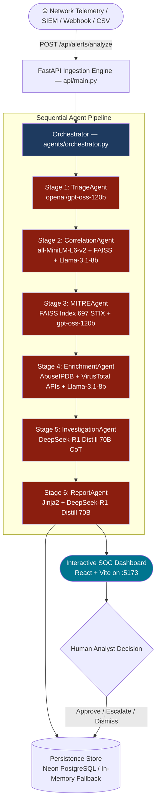

# 🛡️ Autonomous Agentic AI SOC Analyst (MAS-SOC)

[](https://www.python.org/downloads/)
[](https://fastapi.tiangolo.com)
[](https://groq.com)
[](https://vitejs.dev)
[](https://github.com/facebookresearch/faiss)
[](https://neon.tech)
[](tests/)

> An autonomous, multi-agent Security Operations Center (SOC) analyst pipeline that ingests security telemetry, classifies severity, correlates incidents, maps to MITRE ATT&CK, enriches indicators of compromise, reconstructs attack chains with Chain-of-Thought reasoning, and compiles analyst-ready reports — with Human-in-the-Loop decision governance.

---

## 📖 Table of Contents

- [Overview](#-overview)
- [System Architecture](#-system-architecture)
- [The 6-Agent Pipeline](#-the-6-agent-pipeline)
- [Tech Stack](#-tech-stack)
- [Project Directory Structure](#-project-directory-structure)
- [Getting Started](#-getting-started)
  - [Prerequisites](#prerequisites)
  - [1-Click Startup (Recommended)](#1-click-startup-windows)
  - [Manual Step-by-Step Setup](#manual-step-by-step-setup)
- [Configuration (.env)](#-configuration-env)
- [API Endpoints](#-api-endpoints)
- [Dataset & Ground-Truth Benchmarking](#-dataset--ground-truth-benchmarking)
- [Agent Evaluation Metrics Matrix](#-agent-evaluation-metrics-matrix)
- [Testing & Benchmarking](#-testing--benchmarking)
- [License](#-license)

---

## 🔍 Overview

Modern Security Operations Centers face catastrophic **alert fatigue**, processing upwards of 10,000+ daily alerts where over 80–90% are harmless background noise. Traditional rules-based SIEMs lack contextual reasoning, while human tier-1 triage averages 20–45 minutes per incident.

This project implements an **autonomous, end-to-end multi-agent AI system** acting as an automated **Tier 1–2 SOC Analyst**:
- **High-Throughput Triage**: Sub-second severity classification and true/false positive determination.
- **Incident Correlation**: Mathematical grouping of multi-vector attacks across sliding time windows using FAISS embeddings.
- **Semantic MITRE ATT&CK Mapping**: Instant vector retrieval across 697 enterprise techniques.
- **Live Threat Intelligence**: Active enrichment via VirusTotal and AbuseIPDB with automated RFC 1918 private IP filtering.
- **Deep Investigation**: Chain-of-Thought (CoT) reasoning for attack chain synthesis and containment playbooks.
- **Executive & Technical Reporting**: Automated generation of responsive incident summaries and structured JSON.
- **Human-in-the-Loop (HITL)**: Interactive React dashboard for analyst review, action approval, escalation, and dismissal.

---

## 🏗️ System Architecture



---

## 🤖 The 6-Agent Pipeline

All agents inherit from [`agents/base_agent.py`](agents/base_agent.py), providing standard lifecycle logging, latency measurement, and health check interfaces:

| Stage | Agent | Engine / Model | Core Responsibility |
|---|---|---|---|
| **1** | **Triage Agent** | `openai/gpt-oss-120b` *(via Groq)* | Evaluates packet metrics and few-shot exemplars to assign severity (`Critical`, `High`, `Medium`, `Low`) and True/False Positive verdicts. |
| **2** | **Correlation Agent** | `all-MiniLM-L6-v2` + FAISS + `llama-3.1-8b-instant` | Projects flow attributes into 384-dim vector space and correlates events within a 300s window into unified incident IDs. |
| **3** | **MITRE Agent** | FAISS STIX Index + `openai/gpt-oss-120b` | Cosine similarity search against 697 ATT&CK techniques with LLM validation of technique IDs and tactics. |
| **4** | **Enrichment Agent** | VirusTotal & AbuseIPDB APIs + `llama-3.1-8b-instant` | Filters internal RFC 1918 traffic, applies rate-limiting, and queries live public threat reputation scores. |
| **5** | **Investigation Agent** | `deepseek-r1-distill-llama-70b` | Synthesizes all stage findings using Chain-of-Thought (CoT) reasoning to build evidence chains and propose containment actions. |
| **6** | **Report Agent** | Jinja2 Engine + `deepseek-r1-distill-llama-70b` | Compiles comprehensive HTML/JSON investigation reports with visual badges, IOC tables, and response playbooks. |

---

## 🛠️ Tech Stack

### Backend & AI
- **Python 3.11+ / FastAPI**: Async web framework and REST API routing.
- **Groq Cloud LPU™**: Ultra-fast inference hosting open-source models (`openai/gpt-oss-120b`, `llama-3.1-8b-instant`, `deepseek-r1-distill-llama-70b`).
- **sentence-transformers (`all-MiniLM-L6-v2`)**: Generates 384-dimensional dense semantic vectors.
- **FAISS (Facebook AI Similarity Search)**: Vector index for technique retrieval and event clustering.
- **Pydantic v2**: High-performance data validation and contract enforcement.

### Data & Persistence
- **Dual-Mode Persistence**: Seamless synchronization to **Neon Serverless PostgreSQL** with instant failover to a thread-safe in-memory repository for local development and offline environments.
- **Threat Intelligence**: Live integration with VirusTotal (4 req/min rate-limited) and AbuseIPDB.

### Frontend
- **React 18 & Vite**: Fast responsive SOC Dashboard on port `5173`.
- **Proxy Architecture**: Vite dev server proxies `/api` and `/health` requests directly to FastAPI on port `8000`.

---

## 📁 Project Directory Structure

```
SOC-Analyst/
├── agents/                            # Multi-agent AI core
│   ├── base_agent.py                  # Abstract base class for all agents
│   ├── orchestrator.py                # Pipeline controller & stage sequencing
│   ├── llm_client.py                  # Groq client with task-to-model routing
│   ├── triage_agent.py                # Stage 1: Severity & TP/FP classification
│   ├── correlation_agent.py           # Stage 2: Temporal & semantic incident clustering
│   ├── mitre_agent.py                 # Stage 3: MITRE ATT&CK vector mapping
│   ├── enrichment_agent.py            # Stage 4: Live threat intel enrichment
│   ├── investigation_agent.py         # Stage 5: CoT attack chain synthesis
│   ├── report_agent.py                # Stage 6: HTML & JSON report generation
│   └── prompts/                       # Few-shot templates and system prompts
├── api/                               # FastAPI application
│   ├── main.py                        # App entry point, CORS, lifespan handlers
│   ├── models.py                      # Pydantic schemas (NormalizedEvent, AgentResult)
│   └── routes/                        # Modular route controllers
│       ├── alerts.py                  # Alert listing, detail, and analyst actions
│       ├── agents.py                  # Pipeline execution & incident metrics
│       └── reports.py                 # Dynamic incident report endpoints
├── database/                          # Storage layer
│   ├── db.py                          # PostgreSQL (psycopg2 / asyncpg) connection pools
│   └── store.py                       # Thread-safe repository & demo pre-seeding
├── ingestion/                         # Data ingestion & normalization
│   ├── dataset_loader.py              # Ingests CICIDS2017 & UNSW-NB15 datasets
│   ├── normalizer.py                  # Maps raw logs to NormalizedEvent schema
│   ├── faiss_store.py                 # FAISS vector store manager
│   ├── log_generator.py               # Synthetic multi-attack event generator
│   └── mitre_parser.py                # Parses STIX enterprise-attack bundle
├── frontend/                          # Interactive SOC Dashboard (React + Vite)
├── benchmarks/                        # Performance and latency benchmark suites
├── templates/                         # Jinja2 HTML report templates
├── tests/                             # Pytest automated test suite (190+ tests)
├── run_dev.bat                        # Windows 1-click startup script
├── run_dev.sh                         # Linux / macOS startup script
└── requirements.txt                   # Pinned backend dependencies
```

---

## 🚀 Getting Started

### Prerequisites
- **Python**: Version 3.11 or higher (`python --version`)
- **Node.js**: Version 18 or higher (`node --version`)
- **Groq API Key**: Free API key from [console.groq.com](https://console.groq.com)

---

### 1-Click Startup (Windows)

Double-click or run from command prompt:
```bat
run_dev.bat
```
*This verifies Python/Node, auto-generates `.env` from template if missing, installs frontend dependencies, and launches both backend (`:8000`) and frontend (`:5173`) in dedicated windows.*

For Linux / macOS:
```bash
chmod +x run_dev.sh
./run_dev.sh
```

---

### Manual Step-by-Step Setup

#### 1. Configure Environment
```bash
cp .env.example .env
```
Edit `.env` and add your `GROQ_API_KEY`. (Threat intel keys and database URLs are optional).

#### 2. Start the Backend (Terminal 1)
```powershell
# Create & activate virtual environment (optional)
python -m venv .venv
.venv\Scripts\activate

# Install dependencies
pip install -r requirements.txt

# Launch FastAPI server
python -m uvicorn api.main:app --reload --port 8000 --host 0.0.0.0
```

#### 3. Start the Frontend (Terminal 2)
```powershell
cd frontend
npm install
npm run dev
```

#### 4. Open Interfaces
- **SOC Dashboard UI**: [http://localhost:5173](http://localhost:5173)
- **Interactive Swagger Docs**: [http://localhost:8000/docs](http://localhost:8000/docs)
- **Health Check Endpoint**: [http://localhost:8000/health](http://localhost:8000/health)

---

## ⚙️ Configuration (.env)

| Variable | Required? | Default / Purpose |
|---|---|---|
| `GROQ_API_KEY` | **Yes** | Authentication for Groq Cloud LLM inference |
| `GROQ_MODEL_TRIAGE` | No | `openai/gpt-oss-120b` (Classification accuracy) |
| `GROQ_MODEL_CORRELATION`| No | `llama-3.1-8b-instant` (High-volume speed) |
| `GROQ_MODEL_MITRE` | No | `openai/gpt-oss-120b` (Precision ATT&CK tagging) |
| `GROQ_MODEL_ENRICHMENT` | No | `llama-3.1-8b-instant` (Fast lookup reasoning) |
| `GROQ_MODEL_REPORT` | No | `deepseek-r1-distill-llama-70b` (Deep chain-of-thought) |
| `VIRUSTOTAL_API_KEY` | No | Threat reputation scores for external IPs |
| `ABUSEIPDB_API_KEY` | No | IP abuse confidence scoring |
| `NEON_DB_URL` | No | Cloud PostgreSQL connection string (falls back to memory) |
| `CORRELATION_WINDOW_SECONDS` | No | `300` (5-minute sliding window) |

---

## 🌐 API Endpoints

| Method | Endpoint | Description |
|---|---|---|
| `POST` | `/api/analyze` | Ingests a `NormalizedEvent` and executes the full 6-agent pipeline |
| `GET` | `/api/alerts` | Paginated listing of alerts with severity, status, and category filters |
| `GET` | `/api/alerts/{alert_id}` | Detailed alert object with all agent outputs |
| `POST`| `/api/alerts/{alert_id}/action` | Records human analyst decision (`approve`, `escalate`, `dismiss`, `close`) |
| `GET` | `/api/incidents` | Lists correlated incident groups and summarized attack chains |
| `GET` | `/api/stats` | Aggregated dashboard metrics (severity counts, TP/FP rates, latency) |
| `GET` | `/api/reports/{incident_id}` | Fetches or dynamically compiles full investigation report |
| `GET` | `/health` | System and per-agent dependency health status |

---

## 📊 Dataset & Ground-Truth Benchmarking

The system is tested against real-world, peer-reviewed network intrusion datasets:

1. **CICIDS2017**: Contains PCAP-derived flow captures of modern attacks (DDoS, DoS, Brute Force, Port Scan, Web Attacks, Infiltration, Botnet) alongside normal benign activity.
2. **UNSW-NB15**: Contemporary network attack activities with hybrid synthetic and realistic behaviors.
3. **Synthetic Event Generator** ([`ingestion/log_generator.py`](ingestion/log_generator.py)): Produces customizable, multi-vector attack events on-demand for live demonstrations and integration testing.

> **Note on Training vs. Evaluation**: The pipeline **does not** train model weights on CSV rows. Pre-trained foundational LLMs reason over first-principles cyber telemetry. Benchmark datasets provide the **ground-truth labels** to scientifically evaluate accuracy, precision, and false-positive rates.

---

## 📈 Agent Evaluation Metrics Matrix

| Agent | Core Task | Primary Evaluation Metrics | Target Performance |
|---|---|---|---|
| **Triage Agent** | Severity & TP/FP classification | • **Accuracy**: $\frac{TP + TN}{\text{Total}}$<br>• **Precision & Recall**<br>• **F1-Score**: $2 \times \frac{P \times R}{P + R}$<br>• **False Positive Rate (FPR)** | • F1-Score $\ge 0.90$<br>• FPR $< 5\%$ on benign noise<br>• Zero False Negatives on Critical attacks |
| **Correlation Agent** | Incident grouping across time | • **Clustering Precision**<br>• **Correlation Recall** (no split attacks)<br>• **Compression Ratio**: $1 - \frac{\text{Incidents}}{\text{Alerts}}$ | • Compression Ratio $> 70\%$ (major fatigue reduction)<br>• Latency $< 100\text{ms}$ |
| **MITRE Agent** | ATT&CK technique mapping | • **Top-1 & Top-3 Retrieval Accuracy**<br>• **Mean Reciprocal Rank (MRR)**<br>• **Cosine Similarity Score** | • Top-3 Accuracy $\ge 92\%$ on known attack classes |
| **Enrichment Agent** | Threat reputation lookup | • **IOC Hit Rate**<br>• **Rate-Limit Compliance** (0 `429` errors)<br>• **RFC 1918 Filter Accuracy** | • $100\%$ RFC 1918 accuracy<br>• Zero API throttling failures |
| **Investigation Agent** | CoT attack chain synthesis | • **Evidence Grounding Rate** (hallucination-free)<br>• **Analyst Agreement Rate** | • Zero ungrounded claims<br>• $> 85\%$ analyst alignment |
| **Report Agent** | Executive & technical reporting | • **Schema Compliance** (valid HTML/JSON)<br>• **Completeness & Readability** | • $100\%$ valid schema generation<br>• Likert score $\ge 4.5/5.0$ |

---

## 🧪 Testing & Benchmarking

The project maintains comprehensive test coverage across all agents, pipeline stages, and API controllers.

```powershell
# Run the complete test suite (190+ unit and integration tests)
python -m pytest

# Run with verbose output and test names
python -m pytest -v

# Run agent-specific tests
python -m pytest tests/test_triage.py
python -m pytest tests/test_correlation.py
python -m pytest tests/test_mitre.py
python -m pytest tests/test_enrichment.py

# Run the pipeline orchestration latency benchmark
python -m benchmarks.pipeline_benchmark
```

---

## 📄 License

This project is licensed under the **MIT License**.

<div align="center">
<b>Autonomous Agentic AI SOC Analyst</b> • Final Year Project & Research Platform
</div>