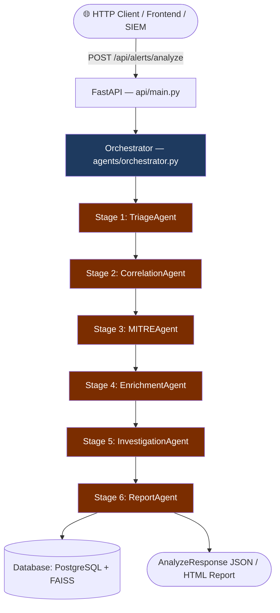
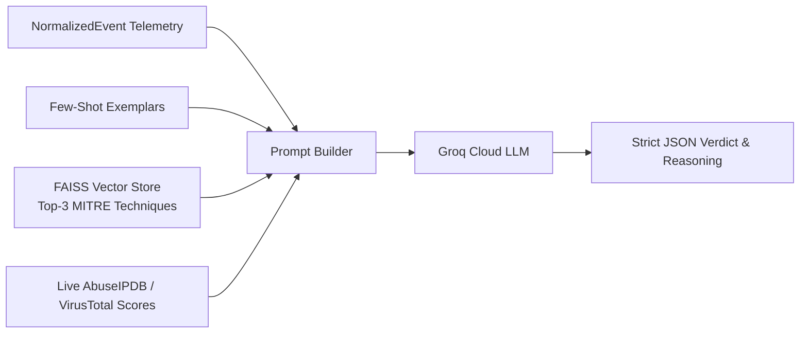

# Autonomous AI-Powered SOC Analyst — Complete Pipeline & Evaluation Guide

This document captures the complete technical explanation and architectural breakdown of the multi-agent SOC Analyst pipeline, including data flow, LLM integration, database usage, data sources, pre-defined knowledge, and the final agent evaluation metrics.

---

## 1. System Architecture & Agent Pipeline Workflow

### Overview
The system implements a sequential, multi-agent AI pipeline built on **FastAPI**, **Groq Cloud LLMs**, **sentence-transformers**, **FAISS**, and **PostgreSQL**. Raw network security events are ingested, normalized into a common data schema, and passed progressively through six specialized agents.

### The Six Pipeline Stages
1. **Stage 1: Triage Agent** (`agents/triage_agent.py`)
   - **Model**: `openai/gpt-oss-120b` via Groq Cloud
   - **Role**: First responder. Analyzes network flow metrics and few-shot examples to classify alert severity (`Critical`, `High`, `Medium`, `Low`) and determine True Positive vs. False Positive.
2. **Stage 2: Correlation Agent** (`agents/correlation_agent.py`)
   - **Model**: `llama-3.1-8b-instant` + `all-MiniLM-L6-v2` + FAISS
   - **Role**: Groups related alerts across a sliding time window (default 300s) and semantic similarity into a single `incident_id`, generating an incident summary.
3. **Stage 3: MITRE Agent** (`agents/mitre_agent.py`)
   - **Model**: `openai/gpt-oss-120b` + FAISS index of MITRE ATT&CK Enterprise STIX
   - **Role**: Embeds the event, searches `techniques.json` for top-3 candidate ATT&CK techniques, and prompts the LLM to verify technique IDs (e.g., `T1595.001`, `T1498`) and tactics.
4. **Stage 4: Enrichment Agent** (`agents/enrichment_agent.py`)
   - **Model**: `llama-3.1-8b-instant` + VirusTotal API + AbuseIPDB API
   - **Role**: Filters private RFC 1918 subnets, queries live threat intelligence APIs for external IP reputation, and derives a structured threat verdict.
5. **Stage 5: Investigation Agent** (`agents/investigation_agent.py`)
   - **Model**: `deepseek-r1-distill-llama-70b`
   - **Role**: Synthesizes cumulative outputs from all prior stages using Chain-of-Thought (CoT) reasoning to produce an attack narrative, evidence list, and recommended actions.
6. **Stage 6: Report Agent** (`agents/report_agent.py`)
   - **Model**: `deepseek-r1-distill-llama-70b` + Jinja2 (`templates/report.html`)
   - **Role**: Transforms findings into an executive-ready security report in HTML and JSON format.

---

## 2. How the LLM "Knows" About Security Events

The LLM is stateless and does not possess direct access to your internal network. It gains knowledge through **Context Injection & Retrieval-Augmented Generation (RAG)**:

1. **Telemetry Injection**: The prompt receives exact flow metrics (`flow_duration`, `flow_bytes_per_sec`, `total_fwd_packets`, `dst_port`, `protocol`).
2. **Few-Shot Domain Guidance**: System prompts in `agents/prompts/triage_prompts.py` teach the model the exact criteria for severity and false positives.
3. **Vector Semantic Retrieval (RAG)**: For MITRE mapping, the system computes vector embeddings using `all-MiniLM-L6-v2`, queries FAISS against `data/mitre_stix/techniques.json`, and feeds the top candidate techniques into the prompt.
4. **Live Threat Intelligence**: The Enrichment agent queries external APIs and inserts actual reputation scores (e.g., *"AbuseIPDB confidence: 100%, 42 reports"*) directly into the prompt.
5. **Chained Context**: Each agent updates the `NormalizedEvent`, allowing downstream agents (Investigation and Report) to access all previously gathered evidence.

---

## 3. Why the Database is Used

LLMs and agent executions are ephemeral. The database (`database/db.py` and `database/store.py`) provides:

| Purpose | What It Stores | Implementation |
|---|---|---|
| **Alert History & Audit Trail** | Every alert, its triage status, severity, and agent execution outputs. | PostgreSQL table / `AlertStore._alerts` |
| **Incident Correlation Over Time** | Grouping multiple events across time windows into a unified incident. | `AlertStore._incidents` |
| **SOC Dashboard Metrics** | Aggregations: Total alerts, Critical/High counts, TP/FP rates, average latency. | `DashboardStats` API model |
| **Human Analyst Feedback** | Analyst decisions (`approve`, `escalate`, `dismiss`) for compliance and evaluation. | `AnalystActionRequest` |
| **Vector Similarity (FAISS)** | 384-dimensional mathematical embeddings for semantic clustering. | `ingestion/faiss_store.py` |

> **Dual-Mode Storage**: When `NEON_DB_URL` is set, the system persists data to cloud PostgreSQL; if offline or running in testing mode, it seamlessly uses an in-memory repository to guarantee zero crashes.

---

## 4. Sources of Data

Data enters the system via three channels:

1. **Benchmark Cyber Datasets** (`ingestion/dataset_loader.py`):
   - **CICIDS2017**: Real-world network flows with benign traffic and attacks (DDoS, PortScan, BruteForce, Infiltration, WebAttacks).
   - **UNSW-NB15**: Modern synthetic and real network traffic.
2. **Synthetic Log Generator** (`ingestion/log_generator.py`):
   - Generates realistic, customizable security events for live testing and development without loading external datasets.
3. **Live REST Ingestion API** (`POST /api/alerts/analyze`):
   - Allows external SIEMs (Splunk, Wazuh, Zeek, Suricata) and web dashboards to stream JSON alerts directly into the pipeline.

All data is standardized by `ingestion/normalizer.py` into the unified `NormalizedEvent` schema.

---

## 5. Why Data is the Core Asset in This Work

1. **Prevents LLM Hallucinations**: Telemetry metrics provide empirical ground truth that constrains the LLM to factual evidence.
2. **Enables Scientific Evaluation**: Benchmark datasets contain ground-truth labels needed to calculate objective metrics (Accuracy, Precision, Recall, F1-Score).
3. **Multi-Event Correlation**: Solves attack chain reconstruction across time windows that a single log cannot capture.
4. **Solves "Alert Fatigue"**: Validates the system's ability to safely dismiss 80–90% benign background noise without missing true attacks.

---

## 6. Pre-Defined Data: What, Why, and Validity

| Agent | Pre-Defined Data Used | Why It Is Needed | Validity & Currency |
|---|---|---|---|
| **Triage Agent** | Few-Shot examples & heuristic severity fallback rules | Enforces strict JSON output schema and ensures zero downtime during API failure. | **Valid**. Packet flow signatures reflect real volumetric attack patterns. |
| **MITRE Agent** | Official MITRE ATT&CK Enterprise STIX dataset (`techniques.json`) + FAISS index | Avoids dumping 600+ techniques into LLM prompt; allows sub-5ms semantic retrieval. | **Valid & Standard**. Follows official MITRE STIX 2.1; updateable anytime via `scripts/build_mitre_index.py`. |
| **Enrichment Agent** | RFC 1918 private subnets & API rate limits | Prevents querying public threat APIs for internal private LAN IPs (`192.168.x.x`). | **100% Valid**. RFC 1918 is an immutable IETF standard established in 1996. |
| **Report Agent** | Jinja2 HTML template & severity color codes | Ensures consistent, formatted presentation for human analysts. | **Valid**. Custom template in `templates/report.html`. |

---

## 7. Clarification on "Benchmark Training Datasets"

A common question in project defenses is whether the LLM is "trained" on benchmark datasets like CICIDS2017:

- **The LLM is NOT trained or fine-tuned on CICIDS2017.** Pre-trained foundation models are used via Groq.
- **CICIDS2017 is strictly an evaluation ground-truth dataset** used to benchmark classification accuracy and false positive rates.
- **Addressing dataset age (2017 vs 2026)**:
  1. The LLM reasons on first principles (packet ratios, protocol behavior), not memorized CSV rows.
  2. The Enrichment Agent augments every alert with **live 2026 Threat Intelligence** from VirusTotal and AbuseIPDB.
  3. The system accepts modern JSON logs via `POST /api/alerts/analyze` and the synthetic generator.

---

## 8. Final Master Table: Agents, Working Mechanisms & Evaluation Metrics

| Agent | Underlying Engine / Model | Core Working Mechanism | Primary Evaluation Metrics | Target / Benchmark Goal |
|---|---|---|---|---|
| **1. Triage Agent** ([`agents/triage_agent.py`](file:///d:/FinalYear_Project/SOC-Analyst/agents/triage_agent.py)) | **Groq Cloud** `openai/gpt-oss-120b` *(Heuristic fallback)* | Ingests `NormalizedEvent` telemetry. Uses few-shot prompt templates to classify severity and determine True vs. False Positive. Outputs strict JSON verdict with reasoning. | • **Accuracy**: $\frac{TP + TN}{Total}$ • **Precision**: $\frac{TP}{TP + FP}$ • **Recall (Sensitivity)**: $\frac{TP}{TP + FN}$ • **F1-Score**: $2 \times \frac{P \times R}{P + R}$ • **False Positive Rate (FPR)**: $\frac{FP}{FP + TN}$ | • $\text{F1} \ge 0.90$ • $\text{FPR} < 5\%$ on benign noise • Zero False Negatives on Critical attacks |
| **2. Correlation Agent** ([`agents/correlation_agent.py`](file:///d:/FinalYear_Project/SOC-Analyst/agents/correlation_agent.py)) | **sentence-transformers** (`all-MiniLM-L6-v2`) + **FAISS** + `llama-3.1-8b-instant` | Generates 384-dimensional vector embeddings. Evaluates incoming events against past alerts using **cosine similarity** ($\ge 0.75$) within a **sliding time window** ($300\text{s}$). Merges related alerts under a unified `incident_id` and summarizes the attack. | • **Incident Clustering Precision** • **Correlation Recall** (no multi-stage attack split) • **Compression Ratio**: $1 - \frac{\text{Unique Incidents}}{\text{Total Raw Alerts}}$ • **Correlation Latency** (ms per event) | • Compression Ratio $> 70\%$ (major alert fatigue reduction) • $< 100\text{ms}$ search latency |
| **3. MITRE Agent** ([`agents/mitre_agent.py`](file:///d:/FinalYear_Project/SOC-Analyst/agents/mitre_agent.py)) | **FAISS FlatIP** (Cosine) + `all-MiniLM-L6-v2` + `gpt-oss-120b` | Embeds the event and queries the pre-computed FAISS index from MITRE STIX data (`techniques.json`). Retrieves top-3 candidate techniques; LLM confirms the best matching technique ID and tactic. | • **Top-1 & Top-3 Retrieval Accuracy** (Hit Rate against ground truth) • **Mean Reciprocal Rank (MRR)**: $\frac{1}{\|Q\|}\sum \frac{1}{\text{rank}_i}$ • **Cosine Similarity Score** | • Top-3 Accuracy $\ge 92\%$ on known benchmark attack classes (e.g. T1595, T1498) |
| **4. Enrichment Agent** ([`agents/enrichment_agent.py`](file:///d:/FinalYear_Project/SOC-Analyst/agents/enrichment_agent.py)) | **External REST APIs** (AbuseIPDB, VirusTotal) + `llama-3.1-8b-instant` | Filters private RFC 1918 traffic. For external IPs, enforces rate limits and queries **VirusTotal & AbuseIPDB**. LLM synthesizes threat reputation into structured output. | • **IOC Hit / Resolution Rate** • **Cache Hit Ratio** • **Rate-Limit Compliance** (0 HTTP 429 errors) • **Heuristic Fallback Reliability** | • $100\%$ RFC 1918 filter accuracy • Zero API throttling failures |
| **5. Investigation Agent** ([`agents/investigation_agent.py`](file:///d:/FinalYear_Project/SOC-Analyst/agents/investigation_agent.py)) | **DeepSeek-R1 Distill** `deepseek-r1-distill-llama-70b` | Synthesizes cumulative outputs from Triage, Correlation, MITRE, and Enrichment using **Chain-of-Thought (CoT)** reasoning. Reconstructs attack timeline, assesses risk level, and specifies containment actions. | • **Evidence Grounding Rate** (hallucination audit: all cited facts must exist in stage outputs) • **Analyst Agreement Rate** ($\%$ human SOC lead approves recommendations) • **CoT Completeness Score** | • Zero ungrounded claims (hallucination-free) • $> 85\%$ analyst alignment |
| **6. Report Agent** ([`agents/report_agent.py`](file:///d:/FinalYear_Project/SOC-Analyst/agents/report_agent.py)) | **Jinja2 Engine** + `deepseek-r1-distill-llama-70b` | Converts JSON outputs into an executive security report in HTML and JSON format with visual badges, IOC tables, MITRE mappings, and response actions. | • **Schema Compliance** (valid HTML and JSON) • **Readability & Coherence** (analyst Likert rating 1–5) • **Completeness** (timeline, IOCs, and actions present) | • $100\%$ schema compliance • Analyst satisfaction $\ge 4.5/5.0$ |

---

### End-to-End System Performance Metrics

- **Pipeline Latency (MTTT)**: Mean Time to Triage — total milliseconds elapsed from log arrival to triage completion (seconds vs. 30–45 minutes manually).
- **MTTR Reduction**: Mean Time to Respond — reduction in time from detection to mitigation approval.
- **Analyst Approval Rate**: Percentage of AI-recommended actions approved without alteration by human-in-the-loop.
- **Token & Cost Efficiency**: Total prompt/completion tokens consumed per analyzed event across the Groq infrastructure.
